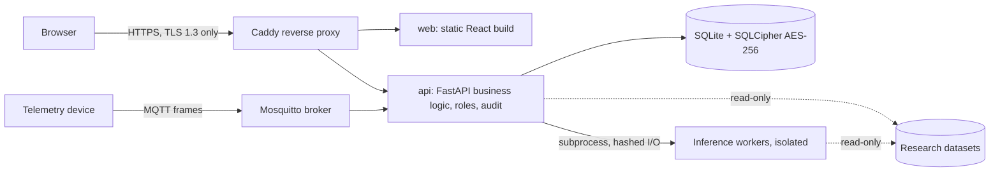

# MEDFORGE

**AI literacy for clinicians: explainable clinical research review and education**, built for HackCure 2026.

AI is arriving in every medical specialty: dose prediction in radiotherapy, video analysis in surgery, signal analysis in vascular access. MEDFORGE trains clinicians to understand and question these tools instead of trusting them blindly. Every number on screen shows where it comes from and how it was computed. Reviewers measure where an AI output disagrees with the reference, and record an accountable human decision. Educators turn the same real cases into graded lessons. MEDFORGE is research and education software.

---

## What MEDFORGE does

| Workspace | Domain | What the user does |
|---|---|---|
| **DoseTwin** (flagship) | Radiotherapy dose planning | Compares an archived AI dose prediction with the benchmark reference on the same grid, inspects differences down to a single voxel, and records a research decision that is frozen, audited and exportable |
| **SurgiVision** | Laparoscopic cholecystectomy, Critical View of Safety (CVS) | Browses expert-annotated surgical frames, filters by annotator agreement, compares frames side by side, and practises CVS judgement before seeing the experts' answers |
| **FistulaGuard** | Hemodialysis arteriovenous fistula signals | Reads measured ECG and piezoelectric vibration signals, with spectral analysis, filters, beat analysis and signal quality rules, plus live framed telemetry from an MQTT device |
| **Model Lab** | All domains | Catalogue of AI models with their versions, licences and verification gates; validates whether an operation may run on a source case |
| **Experiments and Evidence Reports** | All domains | Runs source-bound analyses, traces each operation step by step, and keeps every saved result searchable with its source hashes |
| **Educator Studio and Student Academy** | Medical education | Educators author lessons on real cases, assign them to cohorts and grade against rubrics; students complete staged missions and receive feedback and the expert reference after review |

The research workspaces are independent evidence domains. Their datasets come from unrelated people and are never combined into one patient story.

---

## AI and analysis components

Every output in MEDFORGE carries one of four provenance labels, shown as a badge in the interface:

| Label | Meaning |
|---|---|
| **SOURCE BENCHMARK** | Values or annotations published with the source dataset |
| **ARCHIVED PREDICTION** | Output of a published research model, imported as a file |
| **RULE-BASED METHOD** | A documented, deterministic calculation on source data |
| **IN-APP MODEL INFERENCE** | A model run by MEDFORGE in an isolated worker, with a recorded checkpoint hash |

### DoseTwin: archived AI prediction review engine

- **Prediction import and validation** (`apps/api/app/dose_artifacts.py`): accepts a dose prediction CSV for a case and checks the case identity, the 128 x 128 x 128 grid, the exact voxel spacing, the index convention, the unit (Gy), finite non-negative values and the file SHA-256. Model revision, source revision, optional checkpoint hash and the declared research basis are stored with the file.
- **Same-grid comparison**: computes reference, prediction and signed difference planes on a shared colour scale, and per-structure statistics (reference mean, prediction mean, mean difference, mean absolute difference, maximum absolute difference) with paired dose-volume histograms.
- **Difference inspector**: reads one voxel's reference dose, predicted dose, signed difference and structure memberships, with both source hashes.
- **Research review**: three decisions (*Accept for further expert assessment*, *Request revision*, *Reject research candidate*) with a required rationale. The server recomputes and freezes the evidence, records the reference, prediction, checkpoint and method-code hashes, blocks edits with database triggers, and appends the decision to the audit log. A review can be reopened at its exact structure, plane, slice and voxel, revised by a superseding record, and exported as JSON or as a FHIR R4 bundle.

### DoseTwin: dose statistics engine

- **OpenKBP case analysis** (`apps/api/app/openkbp.py`): loads sparse OpenKBP CT, dose and structure arrays and computes dose-volume histograms and metrics: Dmean, Dmax, D95 (interpolated), D0.1cc, D99, D1 and V20Gy.
- **Evaluator agreement**: on the installed benchmark case, the statistics match the official OpenKBP evaluator on 23 metrics with a maximum difference of 7.647e-06 Gy (`docs/openkbp-pt201-validation.json`).
- **Viewers**: linked orthogonal planes with CT, dose overlay and structure outlines on a fixed case-wide Gy scale, and a 3D structure surface reconstructed with marching cubes (vtk.js).

### SurgiVision: CVS assessment and annotation tools

- **CVS-AdaptNet integration** (`workers/cvs-adaptnet/`): CVS-AdaptNet estimates, for a laparoscopic frame, whether each of the three Critical View of Safety criteria is achieved: two structures entering the gallbladder, a cleared hepatocystic triangle, and an exposed cystic plate. MEDFORGE runs it as an isolated worker process. Before any run, a verification gate checks the worker environment, the checkpoint file against its manifest and SHA-256, the text-encoder files, and the confirmed checkpoint terms. Each run records its input and checkpoint hashes, and identical inputs reuse the stored result.
- **Expert annotation viewer**: COCO bounding boxes and RLE segmentation masks for six anatomical and instrument classes, CVS scores averaged over three annotators, and a 1 fps frame sequence.
- **Annotator agreement browser**: filters frames by split, class, CVS criterion and agreement, so learners can study cases where experts disagreed.
- **CVS self-check**: the student commits three judgements before the annotator values are revealed; the commitment cannot be changed afterwards.

### FistulaGuard: signal analysis pipeline

- **Spectral analysis** (`apps/api/app/fisav.py`): Welch power spectral density (Hann window, 50% overlap, mean detrending) and a bounded time-frequency spectrogram.
- **Filters** (`apps/api/app/signal_processing.py`): 4th-order Butterworth band-pass and IIR notch filters, both applied forward and backward (zero-phase), so features are not shifted in time.
- **Beat analysis**: Pan-Tompkins-style R-peak detection on the ECG, per-beat measurements, and an ensemble-averaged beat aligned on the R-peaks.
- **Quality rules**: six named checks (including clipping, flat-line and sampling regularity); a window that fails is marked "insufficient quality, not scored".
- **Descriptive features**: mean, median, standard deviation, RMS, peak-to-peak, zero fraction and adjacent repeats, each with its formula shown in the interface.
- **Stenosis evaluation worker** (`workers/fisav-stenosis/`): a logistic regression on nine PZT1 features with nested, patient-grouped stratified cross-validation, bootstrap confidence intervals and a permutation test, writing hashed outputs.
- **Telemetry device** (`workers/sim-device/`, `apps/api/app/telemetry.py`): publishes 2 kHz ECG and pulse frames over MQTT. Each binary frame carries a magic header, sequence number, timestamp, sample rate and a CRC32 trailer; the API tracks received frames, CRC failures, malformed frames, missing frames and out-of-order frames, and derives a heart rate from R-peaks.

### Model Lab: registry and gates

The registry (`GET /api/v1/models`) lists seven models across the three domains: CVS-AdaptNet, SurgLatentGraph, an OpenKBP dose prediction baseline, OpenKBP-Opt archived predictions, the OpenKBP-Opt planning optimizer, PortPy planning and a FiSaV baseline. Each entry shows its upstream source revision, licence, operations and readiness state. `POST /api/v1/models/{id}/validate` reports, for a given source case, whether the operation can run and which gates apply.

---

## Architecture



```
 browser ──HTTPS (TLS 1.3 only)──▶ proxy (Caddy, local CA) ─┬─▶ web  (static React build)
                                                            └─▶ api  (FastAPI: business logic, roles, audit)
                                                                  │   SQLite + SQLCipher (AES-256) in the medforge-state volume
                                                                  │   research datasets mounted read-only
                                                                  ├─▶ inference workers (isolated processes, no network)
                                                                  └─◀ mqtt (Mosquitto, private network) ◀─ telemetry device
```

### Layers

| Layer | Technology | Location |
|---|---|---|
| Frontend | React 19.3.0, TypeScript 5.9.3, Vite 8.3.4, Tailwind 4.3.3, shadcn/ui, TanStack Query 5.104.1, Recharts 3.10.1, uPlot 1.6.32, vtk.js 37.4.1, React Flow 12.12.0, dnd-kit 6.3.1 | `src/` |
| API (business logic) | Python 3.13, FastAPI 0.128.2, Pydantic 2.13.5, Uvicorn 0.48.0, NumPy 2.3.5, SciPy 1.16.3, paho-mqtt 2.1.0 | `apps/api/app/` |
| Inference | Isolated Python worker environments started as subprocesses or as a Docker service with no network | `workers/` |
| Database | SQLite with forward migrations replayed safely at start-up; SQLCipher 4 (AES-256) when a key is configured | `db/migrations/`, `apps/api/app/db_driver.py` |
| Proxy and broker | Caddy 2.10.2, Eclipse Mosquitto 2.0.20 | `docker/` |

### Request and data flow

1. The browser talks only to the Caddy proxy over TLS 1.3. Caddy serves the static frontend and forwards `/api/` to the API on the private Docker network.
2. The API validates every request against Pydantic models. The same models generate the OpenAPI contract (`contracts/openapi-implemented.json`) and the TypeScript types used by the frontend (`packages/contracts/generated-api.ts`); CI fails if they drift.
3. Datasets are read from a read-only mount. Each file is verified against a recorded SHA-256 at install time, and frames and records are re-verified when opened. Every response that shows source data carries its source hash.
4. Writes (reviews, imports, reports, grades, submissions) run in a database transaction that also appends the audit entry.
5. Model operations run in a separate worker process with hashed inputs and outputs; the API stores the run keyed by its input hash.

### Identity, roles and access

- Local accounts with PBKDF2-HMAC-SHA256 password hashes (420,000 iterations, per-user salt). Session tokens are random, stored only as SHA-256 hashes, expire after 8 hours and are revoked on sign-out.
- Roles: **student**, **educator**, **clinical reviewer** and **admin**. Research writes need an educator or admin; DoseTwin review routes need a clinical reviewer or admin; review history is scoped to its author.
- Students can open only the cases attached to their assignments, enforced by API middleware; expert references are released only after an educator's review.

### Audit trail

Sensitive actions (sign-in, publishing, assignment, submission, grading, reports, imports, annotations, research decisions, account export and erasure) are written to an append-only, SHA-256 hash-chained audit log in the same transaction as the action. Database triggers block updates and deletes, and `GET /api/v1/audit/verify` walks the chain and reports the first broken link, detecting tampering even if the triggers were bypassed.

### Offline and degraded mode

- The whole stack runs on one machine without internet after the first build.
- Student draft answers are saved in IndexedDB on the device. A submission made offline is queued and replayed once with its original `Idempotency-Key`, so the server records it at most once.
- A service worker precaches the application shell and every built asset (`sw-assets.json`), so screens load without the network. API responses are never cached.

### Interoperability

- Every endpoint is described by the OpenAPI contract and exchanged as structured JSON.
- A DoseTwin review exports as a FHIR R4 Bundle (Patient with a pseudonymous identifier, three dose Observations in Gy with UCUM units, a DiagnosticReport and a Provenance resource with source hashes), validated against the official FHIR R4 JSON schema in the test suite.

### Privacy by design

- Datasets carry pseudonymous source identifiers only; derived labels keep the minimum fields.
- Each account can download its data and erase itself from the **Your data** page: the name, credentials, sessions and roles are removed, and learning records and audit entries are kept under a pseudonymous code so the audit chain stays verifiable.

### Deployment (Docker Compose)

| Service | Role |
|---|---|
| `proxy` | Caddy, TLS 1.3 only, security headers; the only service published, on `127.0.0.1` |
| `web` | Static production build of the frontend |
| `api` | FastAPI application with SQLCipher storage in the `medforge-state` volume; datasets mounted read-only |
| `mqtt` | Mosquitto broker on the private network |
| `sim-device` | Telemetry device (profile `device`) |
| `worker` | Inference and evaluation workers with `network_mode: none` (profile `tools`) |

---

## Quick start with Docker (runs offline)

Prerequisites: Docker Desktop (or Docker Engine with Compose v2) and Node.js 22.

```sh
npm ci                                                # once: frontend dependencies
node scripts/docker-build.mjs                         # once, while online: database key, web build, images
docker compose up -d                                  # proxy, web, api, mqtt
docker compose logs api | grep -A4 "New local accounts"   # demo educator, student and reviewer passwords, shown once
```

Then open <https://localhost:8443>. The certificate comes from a local certificate authority; to trust it, import `docker/certs/medforge-local-root.crt`.

| Task | Command |
|---|---|
| Prove TLS 1.3, and that TLS 1.2 is refused | `node scripts/check-tls.mjs` |
| Prove the database is encrypted at rest | `node scripts/check-db-encryption.mjs` |
| Start the telemetry device | `docker compose --profile device up -d sim-device` |
| Stop everything | `docker compose down` (data stays in the named volumes) |

## Local development install (Windows, macOS, Linux)

Requirements: Python 3.13 and Node.js 22.

```sh
python -m venv apps/api/.venv                      # Windows: py -3.13 -m venv apps/api/.venv
apps/api/.venv/bin/python -m pip install -r apps/api/requirements-test.txt
                                                   # Windows: apps\api\.venv\Scripts\python.exe -m pip install ...
npm ci
npm start                                          # API on 127.0.0.1:8000, web on 127.0.0.1:5173
node scripts/py.mjs scripts/seed_demo.py           # demo accounts, cohort and starter lessons
```

`npm start` runs `scripts/dev.mjs`, which finds the virtual environment on any OS and stops both services together.

## Datasets

Each acquisition script downloads from the official source, verifies checksums, and writes to the git-ignored `data/` folder. Run any script with `--help` first. [`docs/DEMO_DATA_POLICY.md`](docs/DEMO_DATA_POLICY.md) describes what may be shown where, with the attribution for each source.

| Dataset | Script | Licence |
|---|---|---|
| OpenKBP `pt_201` (DoseTwin) | `scripts/acquire_openkbp_pt201.py` | Local research use |
| Endoscapes (SurgiVision) | `scripts/acquire_endoscapes_bbox201.py --split all`, `scripts/acquire_endoscapes_full_release.py` | CC BY-NC-SA 4.0 |
| Appendix300 clip (SurgiVision) | `scripts/acquire_appendix300_sample.py` (needs `ffprobe`) | CC BY 4.0 |
| FiSaV recordings and patient sheet (FistulaGuard) | `scripts/acquire_fisav_sample.py --all-recordings`, `scripts/acquire_fisav_patient_sheet.py` | CC BY 4.0 |

## Tests and checks

| Check | Command |
|---|---|
| API tests | `node scripts/py.mjs -m pytest -q apps/api/tests` |
| Frontend unit tests | `npm run test` |
| Lint and types | `npm run lint`, `npm run typecheck` |
| API contract drift | `npm run contracts:check` |
| Production build | `npm run build` |
| Browser tests | `npm run test:e2e:ci`, `npm run test:e2e:offline` |
| Wording check | `node scripts/py.mjs scripts/check_claims.py` |

CI (`.github/workflows/ui-and-api.yml`) runs these on Ubuntu with Python 3.13 and Node 22.

For the DoseTwin walkthrough and account preparation, see [`RUN_LOCAL.md`](RUN_LOCAL.md) and [`docs/LOCAL_ACCESS_AND_PROFILES.md`](docs/LOCAL_ACCESS_AND_PROFILES.md). [`docs/DEMO_ASSETS.md`](docs/DEMO_ASSETS.md) lists the installed sources and their hashes.
