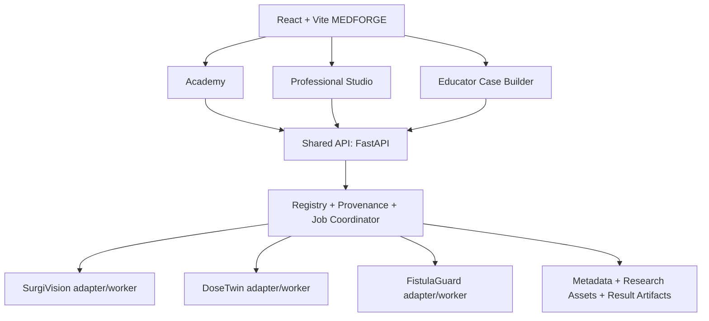

# MEDFORGE — architecture baseline (draft v0.3)

**Status:** DESIGN IN PROGRESS / NOT LOCKED. **Snapshot:** 2026-10-09. **Audience:** Luna XHigh implementation handoff and project team. This file documents previously agreed direction; it does not assert that a repository, model or dataset has already been integrated.

## Mission and scope

MEDFORGE is one research/education platform hosting **three independent scientific engines**: SurgiVision (laparoscopic surgical analysis), DoseTwin (radiotherapy CT/dose evaluation), and FistulaGuard (dialysis vascular-access acoustics). No module is to be discarded or visually stubbed without an explicitly recorded limitation. There is **no claim** that source datasets are from the same patient or that all three algorithms form one diagnostic system.

Two experiences consume the same scientific evidence services: (1) **Professional Studio**, serious research and educator workflows, and (2) **Student Academy**, guided and gamified evidence investigation. A separate **Educator Case Builder** publishes curated activities. A **Researcher** can also use Model Lab and Experiment Center. These represent presentation presets and scoped authorization roles, which are not the same thing.

The platform is **research/educational**, NOT a validated diagnosis, treatment recommendation, medical device or clinical decision-support deployment. No live patient uploads or arbitrary public redistribution of datasets for the hackathon.

## Nonnegotiable technical invariants

1. Real data and result provenance are visible. Never represent reference annotations as live AI, archived AI predictions as current inference, synthetic cases as clinical samples, or a display setting as optimization.
2. Data modality schemas stay typed: timestamp/frame geometry, 3D volume origin/orientation/spacing and dose units, audio channel sample rates/units/sensor locations.
3. All three modules use **Case Registry, Artifact Registry, Module Capability Registry, Model Registry, Job/Run Registry and Reports**. The scientific engines and data remain isolated.
4. Upstream capabilities must be inventoried, pinned to source revisions, attributed and feature-parity tracked. Preserve the opportunity to integrate all supported functions, but do not pretend every checkpoint or solver is available for the weekend demo.
5. Wrong geometry, unknown units, patient leakage, unavailable resources or missing model checkpoints block incompatible analysis.
6. Students never see reference answers before committing their own work. Educators may choose release and review policies.
7. Workspace state is saved per module/case: selected ROI or channel or frame, layers, viewport setup, filters and independent resizable panel layout.
8. Performance and accessibility: lazy load heavyweight scientific viewers; keyboard/focus, screen-size fallbacks, reduced motion, meaningful color legends and numeric units.

## Logical architecture

Deployment MVP: local assets + SQLite + synchronous or lightweight queued background jobs with real status. Growth: PostgreSQL, object store/MinIO, dedicated job queue and GPU/solver compute nodes. **Don't deploy all growth infrastructure before establishing working scientific cases.**

## Screens and route map

| Route | Screen | User goal |
|---|---|---|
| `/` | Entry, mode selection | Decide where to start |
| `/studio` | Professional home | Resume cases, projects, runs |
| `/studio/cases` | Cross-specialty case library | Find accessible cases |
| `/studio/surgivision/cases/:caseId` | Surgical workspace | Explore images, masks, instruments, CVS, timeline |
| `/studio/dosetwin/cases/:caseId` | Dose workspace | Inspect CT, aligned dose, DVH, predictions, discrepancy |
| `/studio/fistulaguard/cases/:caseId` | Acoustic workspace | Inspect channels, waveforms, spectrum, model outputs |
| `/studio/models` | Model Lab | Find installed vs documented models and run readiness checks |
| `/studio/experiments` | Experiment Center | Inference, benchmarks, comparisons, research optimization |
| `/studio/reports` | Reports | Review provenanced scientific outputs |
| `/academy` | Student homepage | Learning paths, saved challenges, progress |
| `/academy/paths/:pathId` | Learning path | Follow curated sequence |
| `/academy/challenges/:challengeId` | Challenge runner | Inspect evidence; commit; reveal; debrief |
| `/educator/cases` | Educator library | Author or manage published activities |
| `/educator/builder/:draftId` | Case Builder | Configure evidence, allowed tools, rubric, release |
| `/educator/assignments/:id` | Review | Evaluate student responses |

## Three medical modules: original capabilities and new product layer

### SurgiVision
- Source datasets: Endoscapes (CVS, anatomy boxes/masks, split), optionally Cholec80/CholecT50 subject to access/licenses.
- Research code: CVS-AdaptNet, SurgLatentGraph model families and runnable video-inference script.
- Product: frame/video viewer; synchronized boxes/masks; tool detection; CVS 3-criterion reference/prediction inspector; phase/action timeline only for correctly compatible data; side-by-side/reference comparisons; annotations and report.
- Future: more model architectures, training and evaluation per official supported scripts.
- Data reality: Endoscapes sampled frames do not guarantee a continuous publicly downloadable surgical video. Some SurgLatentGraph checkpoints are declared coming soon. CVS-AdaptNet test code contains hardcoded `.cuda()` calls, so CPU support is unverified.

### DoseTwin
- Source datasets: OpenKBP (CT/structures/reference dose/spacing); OpenKBP-Opt (100 matched testing cases with archived multi-model predictions, solver inputs, precomputed results).
- Research code: OpenKBP loaders/evaluation; optional RTDosePrediction inference; OpenKBP-Opt and PortPy optimization in isolated environments.
- Product: axial/coronal/sagittal synchronized views; 3D organ meshes only if geometry verified; dose overlays; DVH with correct dose/volume definitions; organ metrics; model/reference comparison; discrepancy location navigator; reports.
- Future: trained neural model inference and optimization. Predictions alone are not deliverable RT plans.
- Data reality: OpenKBP research arrays are not necessarily complete DICOM studies; don't invent physical coordinates. OpenKBP-Opt main optimization needs OR-Tools GUROBI_LP and specialized inputs; not weekend critical path.

### FistulaGuard
- Published basis: FiSaV vascular access sound/vibration/ECG research data (59 patients). Raw access and per-channel details must be verified before implementation commitments.
- Product: documented audio playback where channel supports it, synchronized waveform tracks, selected interval, spectrogram/PSD/FFT and quality assessment; sensor position selector if metadata available; real feature extraction; honest baseline with patient-disjoint eval if labels/data permit.
- Future: cardiac-cycle-aligned feature extraction, multisite model, robustness and calibration.
- Critical rule: a phone microphone is not a validated AVF diagnostic sensor. No clinical stenosis diagnosis claims.

## Shared data and inference lifecycle

`Dataset -> Access Policy -> EvidenceCase -> Typed Asset References -> Validated Analyzer -> AnalysisRun -> Result Artifacts + Provenance -> Specialty Viewer / Evidence Replay / Educational Challenge`.

Analysis jobs: queued -> validating -> running -> completed | failed | cancelled. Every result states `origin: reference_annotation | archived_prediction | live_model_inference | computed_metric | teaching_simulation` and includes source ID + version and hash where possible.

## Upstream feature preservation register

| Repository | Link | Functionality; integration boundary | Verification state |
|---|---|---|---|
| Endoscapes | https://github.com/CAMMA-public/Endoscapes | Dataset/COCO import; split handling | Readme inspected; files not downloaded |
| CVS-AdaptNet | https://github.com/CAMMA-public/CVS-AdaptNet | pretrained CVS, train/test scripts | Code/weights links inspected; checkpoint not executed |
| SurgLatentGraph | https://github.com/CAMMA-public/SurgLatentGraph | detectors, segmentation, CVS, phases, triplets, video-inference script | Source inspected; environment/checkpoints not executed |
| OpenKBP | https://github.com/ababier/open-kbp | dose data loader, baseline net, evaluation | Source inspected; numerical validation not yet run |
| OpenKBP-Opt | https://github.com/ababier/open-kbp-opt | archived predictions, metrics, optimizer | Source inspected; 10GB+ data not downloaded |
| PortPy | https://github.com/PortPy-Project/PortPy | CT, structures, influence matrices, optimization, evaluation | Source inspected; optional worker only |
| FiSaV | https://www.nature.com/articles/s41597-026-08242-8 | acoustic/vibration/ECG data source | Publication identified; raw data not verified |

**Licensing gates:** Preserve upstream NOTICE/LICENSE; Endoscapes/CVS-AdaptNet non-commercial CC restrictions, PortPy Commons Clause restriction, and dataset redistribution permission checks. Never assume a Github repo implies broad rights to clinical datasets or weights.

## Product quality gate

A feature is `implemented` only if authentic data loads, interactions affect real data, numerical/model results have provenance and pass tests, errors work, and its intended laptop performance is acceptable. Separate states: implemented, integrated, needs setup, research-only, blocked/unavailable. Never create inert navigation or simulated results disguised as clinical computations.

## Deferred decisions (not locked)

- Final visual identity: neutral medical-scientific base with teal accent is preferred; choose full tokens with accessibility tests.
- Medical viewer engine: custom OpenKBP canvas/R3F vs Cornerstone3D adapters, based on actual format and orientation conversion.
- Experiment persistence: local database and artifacts vs immediate MLflow integration.
- Fistula dataset raw signal availability and legal allowed usage.
- Public hosting of research datasets, authentication and sign-in flow.
- Actual GPU/CPU runtime and offline demo laptop benchmark.
- Whether experiment graph authoring (React Flow) is Phase 2 or Phase 3.

## External references

OHIF https://docs.ohif.org/3.11/ · Cornerstone https://github.com/cornerstonejs/cornerstone3D · Medplum https://github.com/medplum/medplum · NHS https://service-manual.nhs.uk/design-system/ · PortPy https://github.com/PortPy-Project/PortPy
