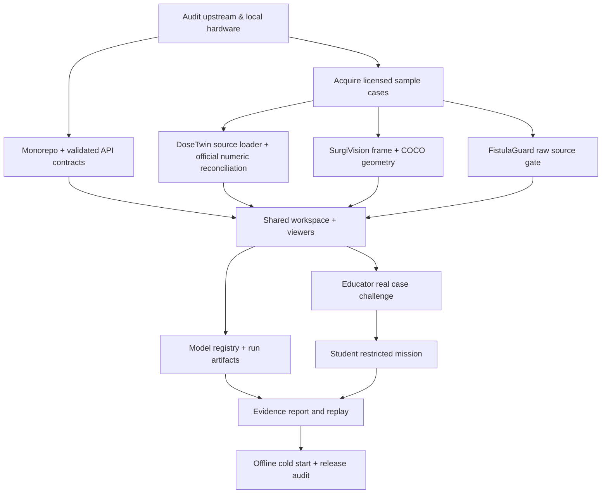

# 28 — Luna XHigh task graph, PR boundaries and test gates (v0.7)

## Dependency graph


## Recommended pull requests (implement each with tests)
| PR | Depends | Scope | Required test | Exit condition |
|---|---|---|---|---|
| `PR-00 foundation` | none | Workspaces, pnpm, Python lock, ESLint, pytest, CI, docs | Typecheck and API smoke | Clean boot, no fake values |
| `PR-01 source-adapters` | 00 | Dataset registry, SHA provenance, typed manifest, import scripts | fixtures + real-case import check | Source data traceable |
| `PR-02 dose-core` | 01 | OpenKBP loader, ROIs, DVH, metrics, geometry rules | official evaluation parity on one real case | Numeric pass with evidence |
| `PR-03 dose-ui` | 02 | MPR benchmark-grid, selection, overlays, DVH inspector | browser voxel/ROI sync | Real analysis visible |
| `PR-04 surgery-core` | 01 | Endoscapes annotation parser, frame viewer, source layers | mask/box alignment sample | Real labeled anatomy visible |
| `PR-05 vascular-core` | 01 | gated recording importer, acoustic features | known-tone signal test + real data rights | Runtime only with true source |
| `PR-06 model-registry` | 02/04/05 | readiness, artifacts, job logs, error handling | blocked tool cannot run, cancellation/status | No fabricated inference |
| `PR-07 learning` | 03/04 | Educator draft/publish + Student answer-safe view | hidden-answer API test | One real case mission works |
| `PR-08 report-replay` | 06/07 | selected output replay, audit export | provenance immutable snapshot | Traceable report |
| `PR-09 release` | all shipping | assets, accessibility, offline, attribution, scripts | cold start, 1366×768, keyboard | Demo safe |

## CI command plan
- Frontend: `pnpm install --frozen-lockfile`, `pnpm typecheck`, `pnpm lint`, `pnpm test`, `pnpm build`, Playwright production preview smoke.
- API: pinned environment installer, `pytest -q`, `ruff check`, Pydantic schema checks, OpenAPI contract snapshot.
- Scientific: `pytest tests/scientific`, numerical tolerance against official evaluation, malformed asset tests, author licensing provenance.
- Security: hidden answer excluded from pre-reveal payload; no backend arbitrary script execution; no path traversal; bearer permissions; safe local URLs.
- Release: `./scripts/demo-up.sh`, open all cards, click every advertised control, no internet dependency for chosen demos; export `STATUS.md` and `DEMO_ASSETS.md`.

## 37-hour allocation (3-4 contributors, dynamically adjust)
- H0–3: audit + source acquisition + hardware/frontend smoke; cut MVP based on facts.
- H3–6: API contracts and shell; freeze interfaces; scientific loader design.
- H6–15: parallel validated DoseTwin, SurgiVision, FistulaGuard conditional ingestion; continuous shared integration.
- H15–23: working views, cross-panel selection, Model Registry, real jobs and reports.
- H23–29: educator→student complete vertical slice and accessibility.
- H29–34: fix correctness, performance, errors, offline dependencies and claims.
- H34–37: full demo, test artifacts, fallback recording/video and license check; no new scope.

## What Luna must report every milestone
```text
MODULE:
WORKING (proven with command/artifact):
SOURCE-ONLY (not yet executing):
REQUIRES SETUP:
BLOCKED:
SCIENTIFIC TEST OUTPUT:
USER-VISIBLE FEATURES:
NEXT CRITICAL STEP:
```
No "everything done" summaries without repo commits + tested screenshots + valid numerical artifacts.

## Hardware and compute decision
Do not assume GPU. Architecture remains laptop/offline-first with separate optional CUDA inference and solver workers. GPU/solver-based advanced parity stays in research roadmap until measured on available machine. Time estimates per task are planning allocations, not promises of future completion.
