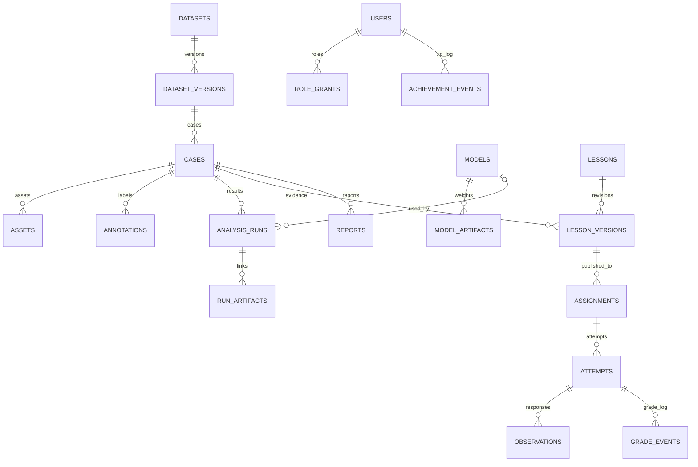

# 32 — Database schema, ownership and invariants

**Source artifact:** `reference_impl/db/migrations/0001_init.sql`. Real, tested SQLite syntax. Multi-user PostgreSQL migration is planned, not generated or tested.

## Logical topology

## Domain ownership
| Group | Tables | API/worker owner |
|---|---|---|
| Identity | users, role_grants | Identity module; not implemented in reference API |
| Evidence | datasets, dataset_versions, cases, assets, annotations | Case/catalog service |
| Models | models, model_artifacts | Model registry + adapter readiness |
| Scientific results | experiments, analysis_runs, run_artifacts, evidence_notes | Job service, provenance service |
| Teaching | lessons, lesson_versions, assignments, attempts, observations, grade_events, achievement_events | Educator/Learning service |
| Reports | reports | Report service |

## Invariants to enforce in application/transactions
- A case is associated with exactly **one** dataset version and exactly **one** specialty. Cross-specialty artificial patient linkage is forbidden.
- An asset has a SHA-256 hash, media type, storage key, coordinate frame/units as appropriate; no path traversal or public raw filesystem paths.
- Mask/dose values must correspond to the same case, and dose voxel order/spacing must match the source protocol.
- Model artifacts are tied to pinned source revisions and hashed checkpoints. Availability is a *derived environment capability*, not a claim inferred merely from DB rows.
- Published lesson versions must be **immutable**. New edits generate the next version and do not mutate historical attempts.
- `student_manifest_json` must exclude `secret_rubric_json`; never send grading keys before authorized reveal.
- Attempts have legal state transitions (`started`→`submitted`→`graded`/`review_required`→`revealed`) validated in transactions; exactly-once submitted grading via idempotency key.
- XP increments are append-only, deduplicated by `unique_event_key`. A retry may not grant points twice.
- A completed run's input hash, parameters, code revision and artifacts are immutable. When inputs change, create a new run.
- AuthN/AuthZ, row-level permission checks, workspace scopes, storage ACLs and secret management are **requirements**, not present in the local harness.

## Storage split
Metadata lives in SQLite MVP, PostgreSQL when scaling. Large CSV, images, videos, checkpoints, waveforms and volumetric data live in a filesystem or blob store; DB retains logical asset references and hashes. Never put private medical files in git. Refuse arbitrary `file://` or filesystem URL input from browsers. Sign temporary object links only after RBAC and license checks.

## Migration acceptance
`python reference_impl/scripts/check_sql_schema.py` checks parsing, 21 tables and enabled FK, not the full invariant list. Production service must add auth enforcement, transactional state-machine tests, migration rollbacks, backup recovery and audit tamper protections.
